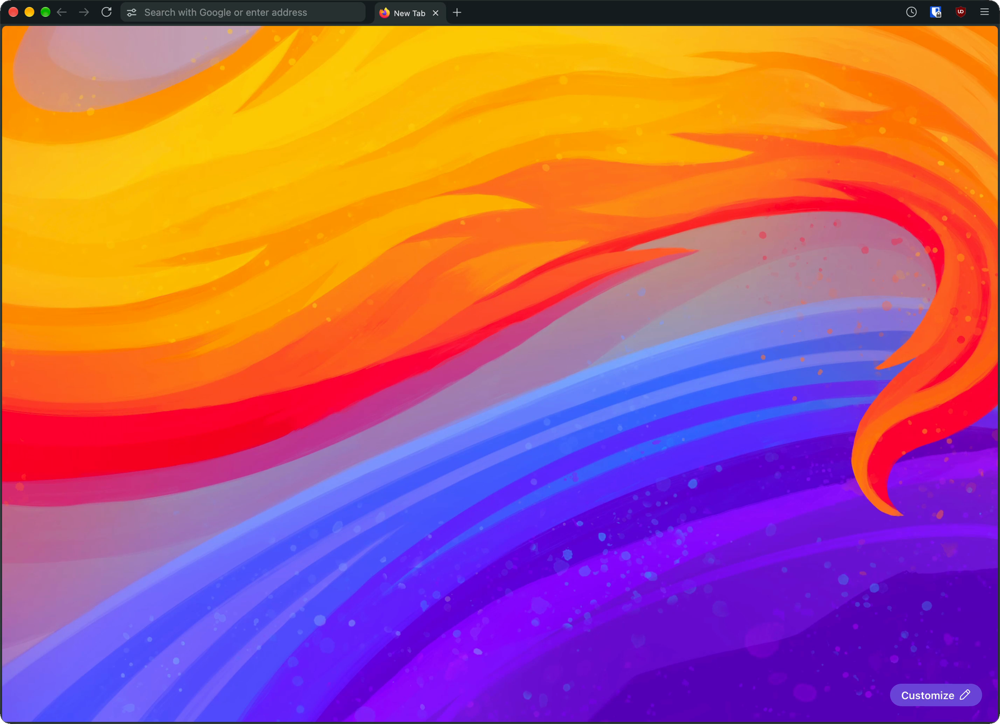
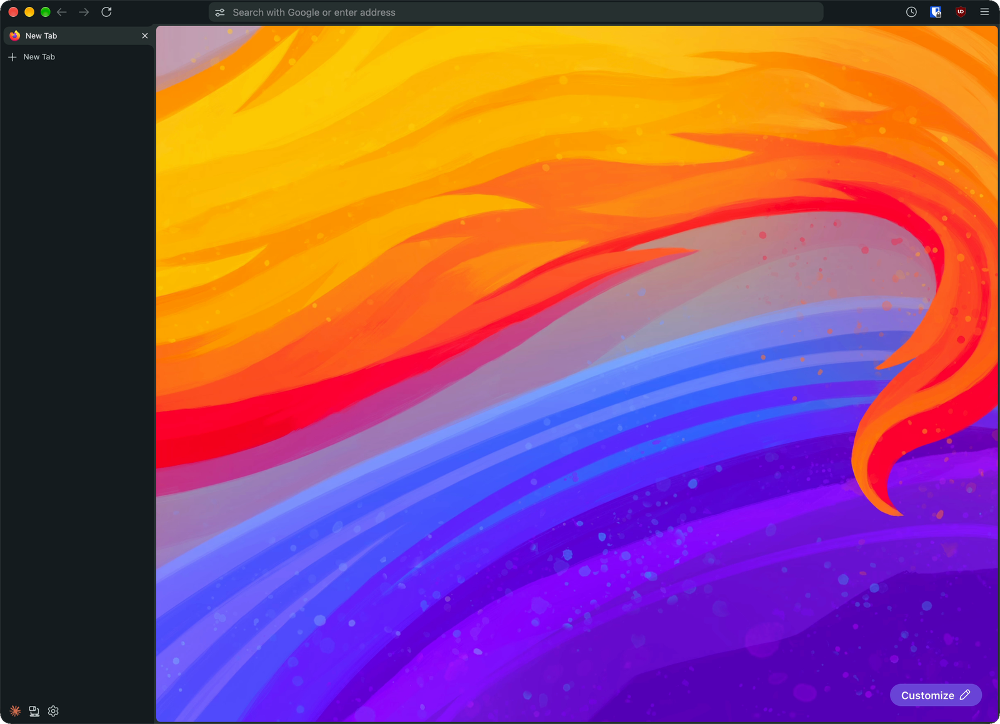
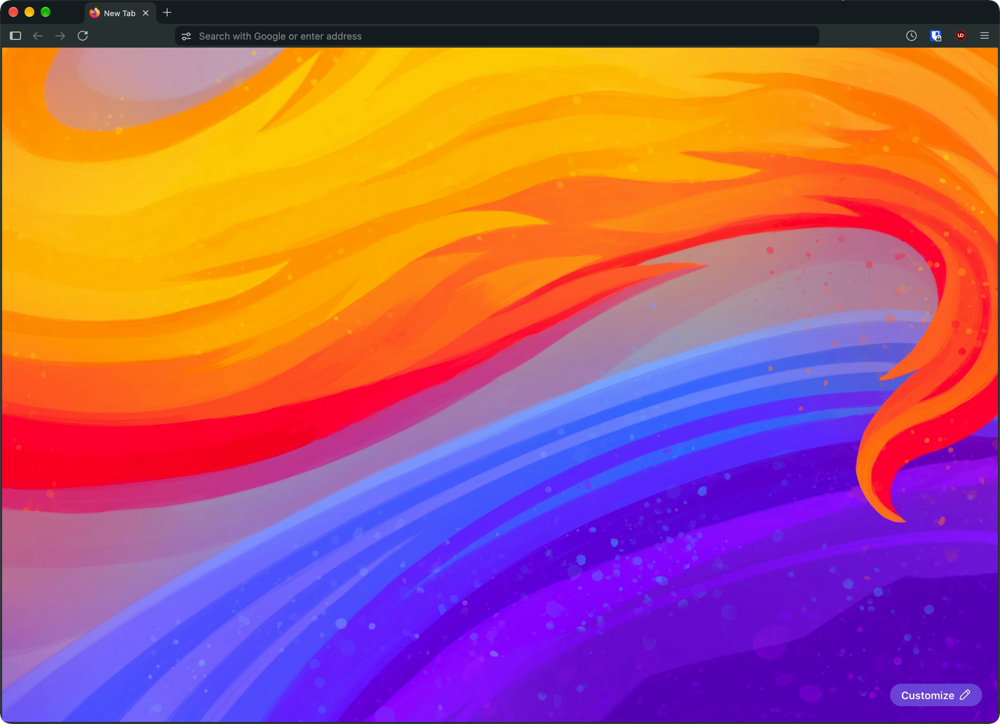

# firefox-helium-skeuomorphic

Helium's look and its three tab layouts, for Firefox on macOS. The active
tab is drawn the way Chrome drew tabs in 2010: it is cut from the same sheet
as the frame around the page and curves into it, so you can see which tab
is open.

The color theme here is **slate**, Helium's dark grey. Other Helium colors
may be added later.

[Helium](https://github.com/imputnet/helium) is a Chromium-based browser.
This is an independent Firefox theme that copies its look; it contains no
Helium code.

| Compact | Vertical | Classic |
|---|---|---|
|  |  |  |

## Know the limits first

- **Firefox 158 on macOS only.** It is built and tested against Firefox
  158.0.1 with the classic interface. Firefox's Nova redesign
  (`browser.nova.enabled`) is not supported. The installer uses macOS
  paths, and compact mode reserves 72px for the macOS window buttons. On a
  newer Firefox, run the check in [Check a new Firefox release](#check-a-new-firefox-release)
  before trusting it.
- **Dark only, one color theme.** Slate is Helium's dark grey theme. Light
  mode is not styled.
- **Two files go inside Firefox.app.** The layout menu needs a few lines of
  JavaScript, and Firefox only runs that from its autoconfig hook inside the
  app bundle. A Firefox update can delete those files. Without them, the
  theme still works but stays in the Classic layout. Editing the bundle also
  makes `codesign --verify` fail; Firefox still starts.
- **Pinned tabs and split view stay as pills.** In the expanded vertical
  sidebar, pinned tabs sit in a grid and can't reach the page, so they are
  plain rounded pills. Split-view pairs are the same.

## Install

1. Quit Firefox.
2. Clone the repo and run the installer:

   ```sh
   git clone https://github.com/animegolem/firefox-helium-skeuomorphic.git
   cd firefox-helium-skeuomorphic
   ./install.sh
   ```

3. Start Firefox.

`install.sh` finds your default profile in `profiles.ini`. To install into
another profile, pass `--profile <profile folder>`. The installer is safe to
run again.

The installer writes three prefs to `user.js` in your profile. Firefox
applies `user.js` every time it starts, so they stay set:

| pref | value | why |
|---|---|---|
| `toolkit.legacyUserProfileCustomizations.stylesheets` | `true` | lets Firefox load `userChrome.css` |
| `browser.uidensity` | `1` | compact density; this tightens all of Firefox, not only the tabs |
| `browser.compactmode.show` | `true` | shows the compact choice under Customize Toolbar › Density |

## Switch layouts from the View menu

Choose **View › Tab Layout**, or right-click any toolbar and choose
**Tab Layout**.

| layout | what you get |
|---|---|
| Classic | Tabs on their own row. The active tab drops into the toolbar below it. |
| Compact (single row) | One row: window buttons, back, forward, reload, a 350px url field, the tabs, then your toolbar buttons at the right edge. The sidebar is hidden. |
| Vertical Tabs | Firefox's vertical tabs. The active tab runs into the page, both when the sidebar is expanded and when it is collapsed. |

Firefox's own **Turn on Vertical Tabs** switch works too. Turning vertical
tabs off returns you to the horizontal layout you used last.

Your toolbar buttons stay at the right edge in every layout. When vertical
tabs are on, Firefox moves the tab strip's buttons, such as New Tab, into
the toolbar; this theme hides them there, because the sidebar has its own
New Tab row.

## Move the tabs in compact by moving the flexible space

In compact, the tabs fill the toolbar's first **Flexible Space** after the
url field. To change what sits left or right of the tabs, open
**Customize Toolbar** and move that Flexible Space. Buttons before it stay
left of the tabs; buttons after it stay right. If there is no Flexible
Space after the url field, the tabs fill the gap before the next button.

While Customize Toolbar is open, compact shows the Classic layout so every
item can be dragged. It returns when you click **Done**.

## Put the Firefox.app files back after an update

To restore the two files by hand after Firefox updates, run:

```sh
./install.sh --app-only
```

To have macOS do it whenever Firefox updates, install the watcher. It
watches `Firefox.app/Contents/Info.plist`, which every update rewrites, and
runs `install.sh --app-only`:

```sh
sed "s#__INSTALL_SH__#$PWD/install.sh#" tools/helium-slate.watch.plist \
  > ~/Library/LaunchAgents/helium-slate.watch.plist
launchctl bootstrap gui/$(id -u) ~/Library/LaunchAgents/helium-slate.watch.plist
```

To remove the watcher, run `launchctl bootout gui/$(id -u)
~/Library/LaunchAgents/helium-slate.watch.plist` and delete the file.

## Change sizes and colors at the top of userChrome.css

The settings are CSS variables at the top of `chrome/userChrome.css`. Edit
them, run `./install.sh`, and restart Firefox.

| variable | default | controls |
|---|---|---|
| `--hs-tab-width` | `104px` | width of a new horizontal tab when there is room (Helium's is 206px) |
| `--hs-row` | `26px` | tab height |
| `--hs-field` | `28px` | url field height; the toolbar row is this plus 6px |
| `--hs-radius` | `8px` | corner radius of tabs and the url field |
| `--hs-flare` | `8px` | size of the curve where the active tab meets the page |
| `--hs-ring` | `3px` | width of the frame around the page |
| `--hs-url-width` | `350px` | url field width in compact |
| `--hs-frame`, `--hs-sheet`, ... | see below | colors |

## The colors are Helium's, derived from its seed

Helium builds its theme from one seed color using Material dynamic color.
The Helium setup this theme copies uses seed `#888888`, variant Neutral,
dark mode. The theme takes these tones from that scheme:

| variable | color | tone | used for |
|---|---|---|---|
| `--hs-frame` | `#182123` | primary 12 | window frame, sidebar |
| `--hs-sheet` | `#2e3839` | see note | url field, active tab, frame around the page |
| `--hs-popup` | `#222b2d` | primary 17 | open url dropdown |
| `--hs-press` | `#3f484a` | primary 30 | pressed buttons, lines |
| `--hs-icon` | `#bfc8ca` | primary 80 | toolbar icons |
| `--hs-dim` | `#c8c6c6` | neutral 80 | secondary text |
| `--hs-text` | `#e4e2e2` | neutral 90 | text |

Helium paints its url field at 80% opacity over the frame. `--hs-sheet` is
the color that results, read from a Helium screenshot, rather than a tone
of the scheme.

To print the tones yourself:

```sh
pip install materialyoucolor
python3 tools/palette.py
```

## Check a new Firefox release

`tools/check.py` drives a running Firefox through each layout using the
real Tab Layout menu. In each layout it measures:

- whether the active tab meets the page or toolbar with no gap
- in compact, whether the tab strip sits on the toolbar row, shows the
  whole active tab, and stays clear of the url field and the buttons
- whether any two toolbar items overlap
- whether the toolbar buttons keep the same distance from the right edge
  in every layout

It saves a screenshot and the measurements for each layout, and exits with a
non-zero status if any check fails. On Firefox 158.0.1, all checks pass.

To run it, install into a throwaway profile, start Firefox with Marionette,
and point the check at it:

```sh
mkdir -p /tmp/hs-prof
echo 'user_pref("marionette.port", 2931);' > /tmp/hs-prof/user.js
./install.sh --profile /tmp/hs-prof
/Applications/Firefox.app/Contents/MacOS/firefox --headless --new-instance \
  --profile /tmp/hs-prof --marionette -remote-allow-system-access &
python3 tools/check.py --port 2931 --out /tmp/hs-check
```

When a check fails after an update, compare the new release's built-in
stylesheets with the old ones. They are in `chrome/browser/skin/classic/browser/`
inside `Firefox.app/Contents/Resources/browser/omni.ja`.

## What's in the repo

| file | installed to | does |
|---|---|---|
| `chrome/userChrome.css` | `<profile>/chrome/` | all the styling |
| `chrome/hs-author.css` | `<profile>/chrome/` | the url-field tune button. Firefox ignores `::part()` rules in `userChrome.css`, so the script loads this file as an author stylesheet. |
| `chrome/hs-layout.uc.js` | `<profile>/chrome/` | the Tab Layout menu, the layout prefs, placing the tabs in compact, and hiding the sidebar in compact |
| `chrome/chrome.manifest` | `<profile>/chrome/` | makes the folder loadable as `chrome://hslate/content/` |
| `app-patch/hs-config.js` | `Firefox.app/Contents/Resources/` | loads `hs-layout.uc.js` into each window |
| `app-patch/defaults/pref/hs-autoconfig.js` | `Firefox.app/Contents/Resources/defaults/pref/` | turns on Firefox's autoconfig hook |
| `tools/check.py`, `tools/mn.py` | not installed | the layout check and its Marionette client |
| `tools/palette.py` | not installed | prints the color tones |
| `tools/helium-slate.watch.plist` | not installed | the optional update watcher |

The layout lives in two prefs: `sidebar.verticalTabs` (Firefox's own) and
`hs.layout.horizontal`, which is `classic` or `compact`.

## Uninstall

1. Quit Firefox.
2. Delete `userChrome.css`, `hs-author.css`, `hs-layout.uc.js`, and
   `chrome.manifest` from `<profile>/chrome/`, and delete `<profile>/user.js`
   if the installer created it.
3. Delete `Firefox.app/Contents/Resources/hs-config.js` and
   `Firefox.app/Contents/Resources/defaults/pref/hs-autoconfig.js`.
4. Start Firefox, open `about:config`, and reset
   `toolkit.legacyUserProfileCustomizations.stylesheets`, `browser.uidensity`,
   `browser.compactmode.show`, and `hs.layout.horizontal`.

## License

MIT. See [LICENSE](LICENSE).
